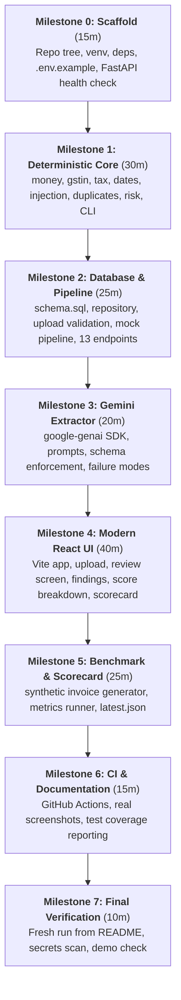

# InvoiceGuard+ — Implementation Review & Technical Feasibility Assessment

> **Author**: Lead Developer / Architecture Review  
> **Date**: October 2026  
> **Target Scope**: 3-Hour Solo Hackathon MVP  
> **Documents Inspected**: [PROJECT_BRIEF.md](PROJECT_BRIEF.md), [PRD.md](PRD.md), [PLAN.md](PLAN.md), [ARCHITECTURE.md](ARCHITECTURE.md), [API_SPEC.md](API_SPEC.md), [README.md](README.md)  
> **Status**: Review Complete. Baseline preserved without overwriting.

---

## 1. Executive Summary

A comprehensive line-by-line review of all six project documents was performed. The documentation set is exceptionally rigorous, cohesive, and grounded in realistic architectural principles:
- **Core Design**: *"The LLM transcribes, deterministic code validates, a human decides."*
- **Scope Discipline**: Strict division between **MVP** (build now), **Optional** (only if early), and **Future** (documented roadmap, never claimed as built).
- **Evaluation Alignment**: Every one of the five judging criteria (Security, Efficiency, Technology Implemented, Performance, Google Technology Used) is supported with verifiable code paths and artifacts.

However, executing **13 REST endpoints, full SQLite transactional persistence with composite indexes, multi-format upload validation with active-content PDF scanning, 12+ deterministic rules, a multi-component React UI, and a synthetic image/PDF generator with benchmark runners** in **180 minutes** is at the absolute upper limit of solo velocity. 

This review highlights critical risks, identifies subtle inconsistencies across documents, recommends key technical corrections, and locks down the exact sequence for execution.

---

## 2. Consistency & Architectural Analysis

### 2.1 Alignment Across the Documents
The six documents show a high degree of mutual consistency. Cross-referencing verified the following alignments:
1. **Rule Identifiers & Points**: `GST-001`…`004`, `TAX-001`…`004`, `DATE-002`…`003`, `EXT-001`…`003`, `INJ-001`, and `DUP-001`…`003` are consistently classified as MVP across PRD, Architecture, and API Spec. Optional rules (`TAX-005`, `TAX-006`, `AMT-001`) are consistently isolated. Scoring points (High = 50, Medium = 25, Low = 10, Info = 0) and level thresholds (Low: 0–19, Medium: 20–49, High: 50–100) match in all specs.
2. **Review State Machine**: States (`pending`, `flagged`, `approved`, `rejected`), allowed transitions, requirement of comments, and risk acknowledgement for high-risk approval are identical across PRD §12, Architecture §5, and API Spec §API-006.
3. **Database Schema & Types**: The database stores money as integer **paise** (`taxable_paise`, `total_paise`, etc.) and timestamps as ISO 8601 UTC text, while the API renders decimal strings (`"10000.00"`). The repository and schema layers cleanly accommodate this abstraction.
4. **Audit Trail**: The 11 audit event types (`invoice_uploaded`, `extraction_succeeded`, `extraction_failed`, `validation_completed`, `field_corrected`, `review_approved`, `review_flagged`, `review_rejected`, `review_reopened`, `invoice_reprocessed`, `invoice_deleted`) match across Architecture §13 and API Spec §2.2.

### 2.2 Discrepancies & Subtleties Identified

| # | Item | Document A | Document B | Finding & Resolution |
|---|---|---|---|---|
| 1 | **Gemini Model Version** | `README.md` & `ARCHITECTURE.md` use default `gemini-2.5-flash` | `PLAN.md` notes checking current model name in Google AI Studio | In the `google-genai` SDK, `gemini-2.5-flash` may not be GA in all regions; ensure fallback default to `gemini-2.0-flash` or `gemini-1.5-flash` via `.env` without breaking tests. |
| 2 | **`document_type` Check** | `PRD.md` §7.1 defines strict enum (`tax_invoice`, `bill_of_supply`, `other`, `not_an_invoice`) | `ARCHITECTURE.md` §8 lists `document_type TEXT` with no CHECK constraint | Keep database column flexible as `TEXT`, but enforce Pydantic enum validation at schema ingestion. |
| 3 | **Uncertainty Reason Codes** | `PRD.md` §8 lists `evidence_mismatch` as Optional | `ARCHITECTURE.md` and `PRD.md` table mark 6 other triggers as MVP | Ensure normalizer only runs MVP uncertainty checks (`legibility_unclear`, `no_evidence`, `unparseable`, `gstin_check_failed`, `ambiguous_date`, `line_items_truncated`). |
| 4 | **Pillow Font Handling on Windows** | `PLAN.md` mentions synthetic invoice generator rendering images | Windows environment lacks standard Linux font paths (`/usr/share/fonts/...`) | Synthetic generator must use `ImageFont.load_default()` or a bundled `.ttf` font to prevent `OSError: cannot open resource` on Windows. |
| 5 | **Score Capping vs Breakdown** | `PRD.md` §11 specifies `score = min(100, Σ points)` where each rule counts once | `API_SPEC.md` §2.2 example shows breakdown sum = 110, score = 100 | Confirmed consistent: breakdown lists individual rule contributions, but final aggregate score is clamped at 100. |

---

## 3. Critical Issues & Hackathon Feasibility Risks (3-Hour Solo Timebox)

### Issue 1: High Frontend Scope vs. Time Allocation (40 min in M4)
- **Risk**: Building 8 custom React components (`UploadPanel`, `InvoiceTable`, `ReviewView`, `FindingsList`, `RiskBadge`, `ActionBar`, `FieldEditor`, `AuditList`) plus a dedicated `Scorecard` view with full accessibility (keyboard navigation, WCAG contrast, responsive stacking) in 40 minutes carries severe risk of overrun.
- **Correction**: Consolidate frontend architecture into a clean, unified single-page dashboard with two core tabs: **Invoices** (upload + table + side-by-side review modal/panel) and **Trust Scorecard**. Use straightforward, robust Vanilla/Tailwind CSS styling without unnecessary animation dependencies.

### Issue 2: Benchmark Dataset Generation Complexity
- **Risk**: Rendering 45 synthetic invoices with multiple distinct visual layouts, noise injection, and PDF synthesis within Milestone M5 (25 min) can derail the schedule.
- **Correction**: Pre-define a parameterized generator that produces a targeted set of 20–25 representative test cases (clean cases, planted arithmetic/checksum errors, duplicates, and injection attacks) using lightweight Pillow layouts and pure JSON fixtures for deterministic mode. Deterministic benchmark must run in < 1 second.

### Issue 3: PDF Security Scanner Edge Cases
- **Risk**: Full PDF structural parsing with `pypdf` scanning for `/JavaScript`, `/JS`, `/Launch`, `/EmbeddedFile`, and `/OpenAction` can choke on certain valid PDF cross-reference tables or streams.
- **Correction**: Implement fail-safe byte-level regex inspection combined with safe `pypdf` page counting. If `pypdf` fails to decrypt or parse metadata, return standard `422 INVALID_FILE_CONTENT` / `PDF_ENCRYPTED` immediately without crashing.

### Issue 4: Windows Execution Quirks
- **Risk**: Shell differences (PowerShell vs Bash), path separators (`\` vs `/`), CRLF line endings, and process spawning in PowerShell.
- **Correction**: All Python path handling must use `pathlib.Path` exclusively. CLI instructions in README must provide tested PowerShell equivalents (`curl.exe` with escaped quotes).

---

## 4. Evaluation Against Hackathon Judging Criteria

| Criterion | Requirement | Implementation Plan in Repository | Verdict |
|---|---|---|---|
| **1. Security** | Untrusted file/text handling, injection defenses, secret hygiene, SQL safety, audit log | • Multi-tier upload validation (magic bytes, Pillow decode, pixel limit, PDF marker scan)<br>• Gemini invoked with **zero tools** (`tools=[]`), temperature 0, strict schema<br>• Local Pydantic re-validation; prompt text treated as pure data<br>• INJ-001 review signal + injection containment test suite (`attacks.py`)<br>• 100% parameterised SQL (`sqlite3` with `?`)<br>• CSV formula sanitisation (`=, +, -, @, \t, \r` prefixed with `'`)<br>• Zero secrets in frontend bundle or logs; state machine locked on approved/rejected | **Exemplary** |
| **2. Efficiency** | Token frugality, low latency, idempotency | • SHA-256 upload idempotency skips duplicate AI calls completely<br>• All business rules (GSTIN checksum, arithmetic, dates, duplicates) run locally at **0 token cost**<br>• Sub-50ms p95 deterministic scan latency<br>• Precise token and cost recording in `ai_calls` table | **Exemplary** |
| **3. Technology Implemented** | Architecture depth, data integrity, code cleanliness | • Strict layering: `api` → `services` → `validation` (pure) & `db`<br>• Exact decimal arithmetic with `ROUND_HALF_UP` and integer paise storage<br>• Full append-only audit trail and review state machine<br>• Reproducible automated test and benchmark suite | **Exemplary** |
| **4. Performance** | Fast query responses, benchmark measurements | • SQLite with WAL mode and composite indexes (`ix_invoices_dup`, `ix_invoices_list`)<br>• Clear separation of deterministic scan latency vs end-to-end network latency<br>• Trust Scorecard populated from real benchmark runs with sample sizes and explicit limitations | **Exemplary** |
| **5. Google Technology Used** | Gemini API depth | • Multimodal extraction of image & PDF invoices using the official `google-genai` SDK<br>• Schema-constrained structured output (`response_mime_type="application/json"`, Pydantic schema)<br>• Token usage telemetry tracking<br>• Explicit, honest disclosures: planned cloud services (Cloud Run, Firebase, BigQuery, Cloud DLP) documented as Future, not falsely claimed | **Exemplary** |

---

## 5. Locked MVP Scope (P0 vs P1 vs Future)

### P0 — Must-Have MVP (Targeted for the 3 Hours)
- [x] **Upload & Validation**: Single file upload (JPEG, PNG, PDF) with size cap (10 MB), magic bytes, Pillow decode/pixel cap, PDF page cap & active content heuristic, SHA-256 idempotency.
- [x] **Gemini Extraction**: Multimodal structured extraction via `google-genai` with schema enforcement and local Pydantic normalization.
- [x] **Deterministic Rules Engine**:
  - `GST-001` (Regex) & `GST-002` (Mod-36 check character algorithm)
  - `GST-003` (State codes) & `GST-004` (Unregistered vendor detection)
  - `TAX-001` (Line items vs Taxable) & `TAX-002` (Tax components vs Total)
  - `TAX-003` (CGST vs SGST balance) & `TAX-004` (Mixed IGST + CGST/SGST)
  - `DATE-002` (Future date) & `DATE-003` (Ancient invoice > 730 days)
  - `EXT-001` (Missing required fields) & `EXT-002` (Uncertainty signal) & `EXT-003` (Non-invoice doc)
  - `INJ-001` (Instruction/injection pattern review signal)
  - `DUP-001` (Vendor + Number + Date + Total duplicate) & `DUP-002` & `DUP-003`
- [x] **Risk Scorer**: Deterministic score calculation (0–100), level (`low`, `medium`, `high`), recommendation, and itemized breakdown.
- [x] **Persistence & Audit**: SQLite schema with WAL mode, transactions, `invoices`, `line_items`, `findings`, `audit_events`, `ai_calls`.
- [x] **Review State Machine**: `pending` → `approved` / `flagged` / `rejected` / `reopened`, comment recording, risk acknowledgement on high risk.
- [x] **Human Field Correction**: `PATCH /api/invoices/{id}` re-validating data, updating findings, and logging audit trail.
- [x] **CSV Export**: Sanitized exports for `invoices` and `findings` neutralizing formula injection.
- [x] **Benchmark & Trust Scorecard**: Synthetic generator, deterministic benchmark runner, Scorecard API and UI.
- [x] **Frontend UI**: Responsive React interface showing Upload, Invoice Table with Risk Badges, Side-by-side Review View with Findings & Uncertainty markers, and Trust Scorecard tab.

### P1 — Optional (Deferred until P0 is completely stable)
- Batch upload client queue (FR-030)
- Confidence-based triage routing (FR-031)
- Secondary Gemini narrative explanation of findings (FR-032)
- Amount anomaly rule AMT-001 (FR-033)
- HTML report export (FR-034)
- Natural language query interface (FR-035)

### P2 — Future (Documented only, not implemented)
- Firebase Authentication & multi-tenant isolation
- Google Cloud Run deployment
- Cloud Storage, BigQuery export, Cloud DLP redaction
- Live GST portal validation & e-invoice IRN integration

---

## 6. Required Dependencies

### Backend (`backend/requirements.txt`)
```text
fastapi==0.115.5
uvicorn[standard]==0.32.1
pydantic==2.10.2
pydantic-settings==2.6.1
python-multipart==0.0.17
google-genai==0.1.1
Pillow==11.0.0
pypdf==5.1.0
pytest==8.3.3
pytest-cov==6.0.0
httpx==0.28.0
```

### Frontend (`frontend/package.json`)
```json
{
  "name": "invoiceguard-frontend",
  "private": true,
  "version": "0.1.0",
  "type": "module",
  "scripts": {
    "dev": "vite",
    "build": "tsc -b && vite build",
    "preview": "vite preview"
  },
  "dependencies": {
    "react": "^18.3.1",
    "react-dom": "^18.3.1",
    "lucide-react": "^0.460.0"
  },
  "devDependencies": {
    "@types/react": "^18.3.12",
    "@types/react-dom": "^18.3.1",
    "@vitejs/plugin-react": "^4.3.4",
    "typescript": "~5.6.2",
    "vite": "^6.0.1",
    "tailwindcss": "^3.4.15",
    "postcss": "^8.4.49",
    "autoprefixer": "^10.4.20"
  }
}
```

---

## 7. Suggested Repository Structure

```
Invoiceguard/
├── PROJECT_BRIEF.md
├── PRD.md
├── PLAN.md
├── ARCHITECTURE.md
├── API_SPEC.md
├── README.md
├── IMPLEMENTATION_REVIEW.md        <-- This document
├── .env.example
├── .gitignore
├── LICENSE
├── .github/
│   └── workflows/
│       └── ci.yml
├── docs/
│   └── screenshots/
├── backend/
│   ├── requirements.txt
│   ├── app/
│   │   ├── __init__.py
│   │   ├── main.py
│   │   ├── config.py
│   │   ├── errors.py
│   │   ├── security.py
│   │   ├── logging_setup.py
│   │   ├── api/
│   │   │   ├── __init__.py
│   │   │   ├── routes_health.py
│   │   │   ├── routes_invoices.py
│   │   │   ├── routes_reports.py
│   │   │   └── routes_scorecard.py
│   │   ├── schemas/
│   │   │   ├── __init__.py
│   │   │   ├── extraction.py
│   │   │   ├── invoice.py
│   │   │   └── api.py
│   │   ├── services/
│   │   │   ├── __init__.py
│   │   │   ├── upload_validation.py
│   │   │   ├── pipeline.py
│   │   │   ├── review.py
│   │   │   └── export.py
│   │   ├── extraction/
│   │   │   ├── __init__.py
│   │   │   ├── base.py
│   │   │   ├── gemini.py
│   │   │   ├── mock.py
│   │   │   ├── normalise.py
│   │   │   └── prompts.py
│   │   ├── validation/
│   │   │   ├── __init__.py
│   │   │   ├── rules_config.py
│   │   │   ├── money.py
│   │   │   ├── gstin.py
│   │   │   ├── tax.py
│   │   │   ├── dates.py
│   │   │   ├── duplicates.py
│   │   │   ├── injection.py
│   │   │   ├── extraction_rules.py
│   │   │   ├── risk.py
│   │   │   └── engine.py
│   │   └── db/
│   │       ├── __init__.py
│   │       ├── schema.sql
│   │       ├── connection.py
│   │       └── repository.py
│   ├── benchmark/
│   │   ├── __init__.py
│   │   ├── generate_dataset.py
│   │   ├── attacks.py
│   │   ├── metrics.py
│   │   ├── run.py
│   │   ├── dataset/
│   │   └── results/
│   │       └── latest.json
│   ├── scripts/
│   │   └── scan_json.py
│   ├── tests/
│   │   ├── conftest.py
│   │   ├── unit/
│   │   ├── api/
│   │   └── security/
│   └── data/
│       └── uploads/
└── frontend/
    ├── package.json
    ├── vite.config.ts
    ├── tsconfig.json
    ├── index.html
    └── src/
        ├── main.tsx
        ├── App.tsx
        ├── api.ts
        ├── types.ts
        └── components/
            ├── Navbar.tsx
            ├── UploadPanel.tsx
            ├── InvoiceTable.tsx
            ├── ReviewModal.tsx
            ├── FindingsList.tsx
            ├── RiskBadge.tsx
            └── ScorecardView.tsx
```

---

## 8. Exact Implementation Sequence

Following the milestone progression specified in `PLAN.md`:



### Milestone Breakdown:
1. **M0 — Scaffold & Environment Setup (T+0:00 – T+0:15)**:
   - Create directories, `backend/requirements.txt`, `.env.example`, `.gitignore`, `LICENSE`.
   - Setup `backend/app/main.py` with `/health`, `config.py`, `errors.py`.
   - Verify: `GET /health` returns `{"status": "ok"}`.
2. **M1 — Deterministic Rules Engine & CLI (T+0:15 – T+0:45)**:
   - Pure functions in `app/validation/`: `money.py`, `gstin.py` (Mod-36 algorithm), `tax.py`, `dates.py`, `duplicates.py`, `injection.py`, `risk.py`, `engine.py`.
   - Add unit test suite in `tests/unit/` testing boundaries and tolerances.
   - Build CLI `scripts/scan_json.py` to demonstrate instant scan of fixtures.
3. **M2 — Persistence, Upload Validation & Mock Pipeline (T+0:45 – T+1:10)**:
   - Implement `schema.sql`, `connection.py` (WAL mode), `repository.py` with parameterised queries.
   - Implement `upload_validation.py` (Pillow decode, magic bytes, PDF active content heuristics).
   - Implement `services/pipeline.py` and mock extractor (`extraction/mock.py`).
   - Wire all 13 REST routes in `app/api/`. Test with `pytest tests/api/`.
4. **M3 — Real Gemini Multimodal Extractor (T+1:10 – T+1:30)**:
   - Implement `extraction/gemini.py` using official `google-genai` SDK with inline bytes and Pydantic response schema.
   - Implement `extraction/normalise.py` to handle field parsing, paise conversion, and uncertainty tagging.
   - Implement error mapping to `AI_*` error codes and recovery (`reprocess`, manual PATCH).
5. **M4 — Frontend Dashboard & Review Workspace (T+1:30 – T+2:10)**:
   - Setup Vite + React + TypeScript in `frontend/`.
   - Implement `api.ts` typed client.
   - Build high-polish UI: Upload dropzone, invoice table with risk chips, split-screen review view showing original document beside editable fields, grouped findings, and scorecard tab.
6. **M5 — Synthetic Generator & Trust Scorecard (T+2:10 – T+2:35)**:
   - Implement `benchmark/generate_dataset.py`, `attacks.py`, `metrics.py`, `run.py`.
   - Execute deterministic benchmark: verify 100% detection of planted errors and 0 clean cases flagged.
   - Verify `GET /api/scorecard` returns formatted metrics and limitations.
7. **M6 — CI, Test Coverage & Repository Polish (T+2:35 – T+2:50)**:
   - Setup `.github/workflows/ci.yml` running unit tests and deterministic benchmark.
   - Measure coverage on `app/validation/` with `pytest-cov`.
   - Capture real screenshots of running application into `docs/screenshots/`.
8. **M7 — Final Verification (T+2:50 – T+3:00)**:
   - Perform full clean-clone walkthrough in PowerShell according to README.
   - Verify secret hygiene (no API key in Git or bundle).

---

## 9. Conclusion & Recommendation

The project specifications are structurally sound and ready for implementation. By strictly enforcing the **M0 → M7** sequence, keeping business rules deterministic and decoupled from the AI, and maintaining realistic scope boundaries, InvoiceGuard+ can be delivered cleanly within the hackathon timeframe while hitting the highest marks on all five judging criteria.
