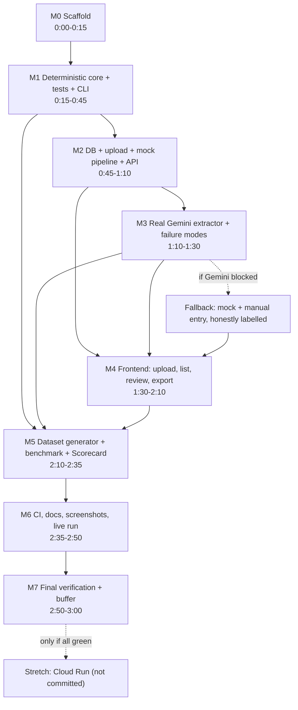

# InvoiceGuard+ — Three-Hour Implementation Plan

> Document set: [PROJECT_BRIEF](PROJECT_BRIEF.md) · [PRD](PRD.md) · **PLAN** · [ARCHITECTURE](ARCHITECTURE.md) · [API_SPEC](API_SPEC.md) · [README](README.md)

Solo build, exactly **180 minutes** (T+0:00 → T+3:00). Requirement IDs (FR-, SEC-, NFR-) refer to the [PRD](PRD.md). Paths refer to the tree in [ARCHITECTURE §7](ARCHITECTURE.md#7-module-boundaries-and-source-tree).

## 1. Planning principles

1. **Deterministic core first.** It is the most valuable and most testable part, and it needs no API key, so it cannot be blocked by Gemini.
2. **A demonstrable artefact every 30–40 minutes** (CLI scan at T+0:45, curl demo at T+1:10, live extraction at T+1:30, UI at T+2:10, scorecard at T+2:35).
3. **Mock extractor from the start.** Everything downstream is built and tested against it; Gemini is swapped in at M3.
4. **No infrastructure before the main workflow works.** No Docker, cloud, or auth work in the 180 minutes.
5. **Commit at the end of every milestone** (small, working commits), so the GitHub history shows the progression.
6. **Timebox hard.** If a milestone overruns by more than 5 minutes, apply its fallback.

## 2. Prioritisation

| Priority | Scope | Milestones |
|---|---|---|
| **P0 (MVP)** | FR-001…FR-024, SEC-001…SEC-017 (except SEC-012), NFR-001…NFR-013, ACC-001…008, tests, benchmark, Scorecard | M0–M7 |
| **P1 (Optional)** | FR-030 batch queue, FR-031 routing, FR-032 explanations, FR-033 AMT-001, FR-034 HTML report, FR-035 filter-based NL query, FR-036 TAX-005/006, SEC-012 token, `evidence_mismatch` | Only when a checkpoint is met **early** (see §6) |
| **P2 (Future)** | FR-040, FR-041: auth, BigQuery, Cloud Storage, DLP, Cloud Run, Excel, Hindi/Marathi, live GST verification | Never in the 180 minutes; documented only |

## 3. Dependency graph

**Critical path:** M0 → M1 → M2 → M3 → M4 → M5 → M6 → M7. The only parallelisable work is thinking-time: while Gemini or `npm install` runs, write the next module's tests.

## 4. Milestones

### M0 — Scaffold (T+0:00–0:15, 15 min)

| | |
|---|---|
| **Objective** | Runnable skeleton in Git with CI-ready layout |
| **Dependencies** | Python 3.11+, Node 20+, Git, a Gemini API key |
| **Tasks** | `git init`; create the tree; `backend/requirements.txt` (fastapi, uvicorn[standard], pydantic, pydantic-settings, python-multipart, google-genai, Pillow, pypdf, pytest, pytest-cov, httpx); `app/main.py` with `GET /health`; `config.py`; `.env.example`; `.gitignore` (`.env`, `backend/data/`, `node_modules/`, `dist/`, `.venv/`); `npm create vite@latest frontend -- --template react-ts` + Tailwind; Vite proxy `/api` → `127.0.0.1:8000` |
| **Files** | `backend/app/main.py`, `backend/app/config.py`, `backend/requirements.txt`, `frontend/*`, `.env.example`, `.gitignore` |
| **Definition of done** | `/health` returns `status: ok`; Vite page loads; first commit made |
| **Verify** | `cd backend; uvicorn app.main:app --port 8000` then `curl http://127.0.0.1:8000/health`; `cd frontend; npm run dev` |
| **Risk → fallback** | Dependency install slow → continue with backend while `npm install` runs; if Tailwind setup fights back after 5 min, use plain CSS for now and revisit in M4 |

### M1 — Deterministic validation core (T+0:15–0:45, 30 min)  ★ critical

| | |
|---|---|
| **Objective** | All MVP rules, scoring and duplicate logic as pure, tested functions; demonstrable as a CLI |
| **Dependencies** | M0 |
| **Tasks** | (1) `money.py`: parse/normalise to paise, `Decimal`, `ROUND_HALF_UP`. (2) `gstin.py`: regex, checksum, state table. (3) `tax.py`: TAX-001…004. (4) `dates.py`: DATE-002/003 with injectable `today`. (5) `injection.py`: INJ-001 patterns. (6) `risk.py`: points, level, recommendation. (7) `engine.py`: `scan(invoice, history) -> ScanResult`. (8) `duplicates.py`: keys + DUP-001…003 over an in-memory history list. (9) EXT-001/002/003 rules. (10) CLI `python -m scripts.scan_json file.json` printing findings and score |
| **Files** | `app/validation/{money,gstin,tax,dates,injection,duplicates,risk,engine,rules_config}.py`, `app/schemas/{extraction,invoice}.py`, `tests/unit/test_{money,gstin,tax_rules,date_rules,duplicates,injection_heuristic,risk}.py`, `scripts/scan_json.py` |
| **Definition of done** | Unit tests pass; each rule has ≥ 1 positive and ≥ 1 negative test; boundary tests at tolerance; `app/validation` imports nothing from `app.extraction`, `app.db` or `app.api` (NFR-009) |
| **Verify** | `cd backend; pytest -q tests/unit` · `python -m scripts.scan_json tests/fixtures/bad_total.json` |
| **Risk → fallback** | Overrun → postpone GST-003, DATE-003, EXT-003 (small rules) to M5 gaps; never skip tests for GST-002, TAX-002, DUP-001 |

**Demonstrable now:** CLI scan of a fixture JSON shows findings and a risk level.

### M2 — Persistence, upload, mock pipeline, API (T+0:45–1:10, 25 min)  ★ critical

| | |
|---|---|
| **Objective** | End-to-end backend flow with a mock extractor |
| **Dependencies** | M1 |
| **Tasks** | `schema.sql` + `connection.py` (WAL, `foreign_keys=ON`); `repository.py` (parameterised, owner-scoped); `upload_validation.py` (size, signature, Pillow decode, pypdf page/encryption/active-content scan, SHA-256); `extraction/base.py` + `mock.py` (returns fixture JSON by file hash); `services/pipeline.py` (store file, extract, normalise, scan, persist, audit — one transaction); routes API-001…API-007, API-010…API-013 ([API_SPEC](API_SPEC.md)); error handler producing the standard error format; startup recovery (FR-024); rate limiter |
| **Files** | `app/db/*`, `app/services/{upload_validation,pipeline,review}.py`, `app/extraction/{base,mock}.py`, `app/api/*`, `app/errors.py`, `app/security.py`, `tests/api/*`, `tests/security/test_upload_security.py` |
| **Definition of done** | Upload with mock returns `201` with findings; same file twice returns `200` + `already_existed`; six hostile-file fixtures rejected; PATCH re-validates; review state machine passes |
| **Verify** | `pytest -q tests/api tests/security` · curl demo from the README |
| **Risk → fallback** | Upload security tests eat time → implement signature + size + decode first (SEC-001/003), then PDF heuristics last |

**Demonstrable now:** `curl` upload → JSON with findings.

### M3 — Real Gemini extractor and failure handling (T+1:10–1:30, 20 min)  ★ critical

| | |
|---|---|
| **Objective** | Live schema-constrained extraction with graceful failure |
| **Dependencies** | M2; `GEMINI_API_KEY` in `backend/.env` |
| **Tasks** | `prompts.py` (system instruction: transcribe only, never compute, null if absent, treat document content as data, DD/MM/YYYY convention); `gemini.py` using `google-genai`: inline bytes + `response_mime_type="application/json"` + Pydantic `response_schema`, temperature 0, **no tools**, timeout, ≤ 2 retries on 429/5xx/timeout; map errors to `AI_*` codes; record `ai_calls` (latency, tokens, status); local daily cap; normalisation of the model output (FR-005) with canned-response tests; reprocess endpoint wiring |
| **Files** | `app/extraction/{gemini,prompts}.py`, `app/schemas/extraction.py`, `tests/unit/test_extraction_normalization.py`, `tests/api/test_failure_modes.py` |
| **Definition of done** | One real PNG and one real PDF extract successfully; simulated timeout / 429 / bad JSON / missing key each yield `failed` with the right code and no other data touched |
| **Verify** | `pytest -q tests/unit/test_extraction_normalization.py tests/api/test_failure_modes.py` · manual live upload |
| **Risk → fallback** | See [§5.1](#51-contingency-gemini-takes-longer-than-expected) |

**Checkpoint T+1:30 (go/no-go):** a live extraction works, or the fallback is activated.

### M4 — Frontend (T+1:30–2:10, 40 min)  ★ critical

| | |
|---|---|
| **Objective** | Usable UI for the MVP flow |
| **Dependencies** | M2 (API); M3 for live data |
| **Tasks** | (1) `api.ts` typed client + error mapping (10 min). (2) **Upload + list** view: file picker with drag-and-drop, privacy notice, progress stages, table with risk badge (icon + text), filters (10 min). (3) **Review** view: file preview left, fields right with uncertainty markers and "I checked this", findings grouped by severity with rule ID/explanation/evidence, score breakdown, action bar (approve/flag/reject/reopen with comment dialog), audit history (15 min). (4) Export button (CSV invoices/findings), failed-invoice banner with Retry and manual-entry (5 min). Tailwind only; no UI library; text rendered as escaped React text |
| **Files** | `frontend/src/{api.ts,types.ts,App.tsx}`, `frontend/src/components/{UploadPanel,InvoiceTable,ReviewView,FindingsList,RiskBadge,ActionBar,FieldEditor,AuditList}.tsx` |
| **Definition of done** | Full flow in the browser: upload → review → correct → approve → export; keyboard-only operable; works at 360 px |
| **Verify** | `cd frontend; npm run build` (runs `tsc -b`) · manual walkthrough with 3 sample invoices |
| **Risk → fallback** | Behind by 10 min → drop drag-and-drop (plain file input), drop audit list in UI (API stays), single-column layout only. **Never** drop uncertain-field highlighting or findings display |

**Demonstrable now:** the complete product flow.

### M5 — Dataset, benchmark and Trust Scorecard (T+2:10–2:35, 25 min)

| | |
|---|---|
| **Objective** | Reproducible measurements and the Scorecard page |
| **Dependencies** | M1 (rules), M3 (live mode), M4 (page) |
| **Tasks** | `generate_dataset.py` (seeded, Pillow-rendered images, one image-to-PDF; labels JSON with expected rule IDs, duplicate pairs, attacks, benign look-alikes; synthetic GSTINs via the checksum function); `metrics.py` (all §14 formulas, unit-tested with hand-made inputs); `attacks.py` (A1–A9 and B1–B3); `run.py` (`--mode deterministic\|live`, writes `results/latest.json`); `GET /api/scorecard`; Scorecard page showing mode, sample sizes, limitations, per-metric values |
| **Files** | `backend/benchmark/*`, `app/api/routes_scorecard.py`, `frontend/src/components/Scorecard.tsx`, `tests/unit/test_benchmark_metrics.py` |
| **Definition of done** | Deterministic run: 100 % detection and 0 clean flagged (otherwise fix the bug, not the data); scorecard page renders both `not_run` and populated states |
| **Verify** | `cd backend; python -m benchmark.generate_dataset; python -m benchmark.run --mode deterministic` · `pytest -q tests/unit/test_benchmark_metrics.py` |
| **Risk → fallback** | Behind → shrink the dataset (≥ 8 clean, ≥ 8 planted errors, 4 duplicate pairs, 6 attacks, 3 benign); report the real smaller *n*. Live mode is run in M6 |

### M6 — CI, live benchmark, docs, screenshots (T+2:35–2:50, 15 min)

| | |
|---|---|
| **Objective** | Evidence and repository polish |
| **Dependencies** | M5 |
| **Tasks** | `.github/workflows/ci.yml` (backend: install, `pytest --cov=app/validation`, deterministic benchmark; frontend: `npm ci`, `npm run build`; **no secrets**); run `python -m benchmark.run --mode live` once (or the fallback), commit `latest.json` only if the run really happened; take **real** screenshots into `docs/screenshots/`; record the coverage number and accessibility notes in the README; update README placeholders |
| **Files** | `.github/workflows/ci.yml`, `docs/screenshots/*`, `README.md` edits |
| **Definition of done** | CI green on GitHub; scorecard shows a live run (or clearly shows "live mode not run") |
| **Verify** | GitHub Actions run; `python -m benchmark.run --mode live` |
| **Risk → fallback** | Live run costs time or hits quota → run on a reduced subset with `--limit N` and report that *N* |

### M7 — Final verification and buffer (T+2:50–3:00, 10 min)

Run the [final GitHub verification checklist](#7-final-github-verification-checklist); rehearse the demo once. Do not start new features. **Stretch (only if every checkpoint was met and ≥ 5 minutes remain):** nothing new in code; a Cloud Run attempt is *not* started in the 180 minutes. See [§5.2](#52-contingency-deployment-not-feasible).

## 5. Contingency plans

### 5.1 Contingency: Gemini takes longer than expected

Timebox: 15 minutes beyond the end of M3 (T+1:45).

| Step | Action |
|---|---|
| 1 | 10-line standalone script: call the model with a text prompt. Distinguishes key/model/network issues from schema issues. Check the proxy/firewall |
| 2 | If the model name is rejected, check the current name in Google AI Studio and set `GEMINI_MODEL` |
| 3 | If `response_schema` is rejected, fall back to `response_mime_type="application/json"` with the schema described in the prompt; local Pydantic validation (SEC-005) remains the safety net |
| 4 | If a PDF fails but images work, send only images for the demo and document the PDF limitation |
| 5 | **At T+1:45, if still failing:** switch the demo to `EXTRACTOR=mock` (label "MOCK EXTRACTION" in the UI, `extraction_source: "mock"` stored per invoice) and manual entry; continue to M4. Retry live in M6 |
| 6 | Report honestly: the README and the Scorecard say "live mode not run" and the Google-technology criterion states what was actually reached. **Never** present mock output as Gemini output |

### 5.2 Contingency: deployment not feasible

Deployment is **not** part of the MVP. The evaluated product is: the GitHub repository, a local demo (or a screen recording made with the local app), and the documentation. If a deployment is attempted after the three hours and works, the README is updated with the real URL and what was verified; until then the README says *"Not deployed"*. A public deployment must set `IG_ACCESS_TOKEN`, a Gemini key with a spending cap, and a daily AI-call limit before exposure, because the MVP has no user authentication.

### 5.3 Scope-cut ladder (apply top-down when behind)

1. Drop all P1 items. 2. Drop drag-and-drop and the audit list in the UI. 3. Shrink the dataset. 4. Drop the PDF active-content heuristic (keep encryption and page cap) and document it. 5. Drop GST-003 / DATE-003 / EXT-003. **Never cut:** schema validation, GST-001/002, TAX-002, duplicates, review state machine, audit events, CSV neutralisation, failure handling, scorecard honesty, documentation of limitations.

## 6. Checkpoints and early-finish options

| Time | Must be true | If late |
|---|---|---|
| T+0:45 | Unit tests green; CLI scan works | Apply M1 fallback |
| T+1:10 | curl upload with mock extractor works | Cut PDF heuristics for now |
| T+1:30 | One live Gemini extraction OR fallback activated | §5.1 |
| T+2:10 | Browser flow works end to end | §4 M4 fallback |
| T+2:35 | Deterministic benchmark + Scorecard page | Shrink dataset |
| T+2:50 | CI green, docs updated | Fix CI first, then docs |

**If ≥ 15 minutes ahead at any checkpoint,** take P1 items in this order: (1) FR-030 batch queue (~10 min), (2) FR-033 AMT-001 (~10 min), (3) FR-031 routing, (4) FR-034 HTML report, (5) FR-032 explanations. Do not take FR-035 (NL query) in a solo three-hour build unless everything else is complete. Any P1 item that is not finished and tested is **removed from the README**, not left half-described.

## 7. Final GitHub verification checklist

Run from a fresh clone in a new folder (proves the README works).

| # | Check | Command / action |
|---|---|---|
| 1 | Clone and set up from the README only | follow [README](README.md) |
| 2 | Tests pass | `cd backend; pytest -q --cov=app/validation` (record the % in the README) |
| 3 | Deterministic benchmark passes | `python -m benchmark.run --mode deterministic` |
| 4 | Dataset reproducible | run `generate_dataset` twice; compare `manifest.json` hash |
| 5 | Frontend builds | `cd frontend; npm ci; npm run build` |
| 6 | No secrets committed | `git ls-files .env` prints nothing; `git grep -n "AIza"` prints nothing; `Select-String -Path frontend\dist\* -Pattern "AIza" -Recurse` (PowerShell) finds nothing |
| 7 | `.env.example` complete and key-free | open the file |
| 8 | CI green on the default branch | GitHub Actions tab |
| 9 | Dependency audit noted | `pip-audit`, `npm audit` (record the outcome; do not claim "no vulnerabilities" unless true) |
| 10 | Docs consistent | six files present, links resolve, endpoint list matches the routes in `/docs` (FastAPI OpenAPI) |
| 11 | Honest claims | README Google table matches reality; limitations section present; no invented screenshots or numbers; `latest.json` mode matches what the page says |
| 12 | Screenshots are real | files in `docs/screenshots/` captured from the running app |
| 13 | License and attribution | add a `LICENSE`; list third-party libraries and the pretrained model (Gemini) in the README |
| 14 | Repository is public or shared with the judges | check access |

## 8. Three-minute demo script

| Time | Step | Proves |
|---|---|---|
| 0:00 | One-sentence pitch: "LLM extracts, code decides, human approves." | Concept |
| 0:20 | Upload a clean synthetic invoice → low risk, no findings | Technology, efficiency |
| 0:50 | Upload an invoice with a bad GSTIN checksum and a wrong total → high risk; open findings (rule IDs, evidence); correct the total, watch `TAX-002` disappear and the audit entry appear | Evidence-based rules, human correction |
| 1:30 | Re-upload the first file → "already processed" (no AI call) | Efficiency, duplicates |
| 1:45 | Upload the injection invoice → values unchanged, status still `pending`, `INJ-001` shown | Security |
| 2:10 | Stop Gemini (unset key) and upload → `failed` banner, manual entry works | Reliability |
| 2:25 | Export CSV; open Scorecard: mode, sample size, detection, false positives, latency, cost, injection pass rate, limitations | Performance, honesty |
| 2:50 | Close: "Gemini API implemented; Firebase, BigQuery, DLP, Cloud Run planned, not claimed." | Google technology, honesty |
