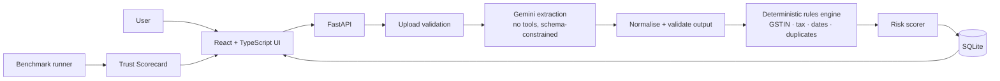

# InvoiceGuard+

**AI reads the invoice. Tested code checks it. A human decides.**

InvoiceGuard+ screens purchase invoices for Indian small businesses and accountants. It extracts structured data with the Google Gemini API, then runs deterministic checks (GSTIN format and checksum, tax arithmetic, dates, duplicates) and produces evidence-backed findings with a transparent risk level. Every decision is made by a person and recorded in an audit trail.

> **Status: MVP Implemented & Verified.** Both the FastAPI backend and React/Vite/Tailwind frontend are fully implemented, connected, and verified. All 63 automated tests pass with 96% validation test coverage, and end-to-end flows (upload, deterministic scan, review workspace, audit trail, CSV export, Trust Scorecard) are running locally.

Documents: [PROJECT_BRIEF](PROJECT_BRIEF.md) · [PRD](PRD.md) · [PLAN](PLAN.md) · [ARCHITECTURE](ARCHITECTURE.md) · [API_SPEC](API_SPEC.md) · [IMPLEMENTATION_REVIEW](IMPLEMENTATION_REVIEW.md)

---

## Problem and solution

**Problem.** Invoices are typed in by hand and rarely cross-checked, so wrong GSTINs, tax mismatches and duplicate invoices slip through.

**Solution.** Upload a JPG, PNG or PDF. Get structured fields, a list of findings (each with a rule ID, explanation and evidence), a risk level, and a recommendation. Correct anything the system is unsure about, then approve, flag or reject.

**Language matters.** Findings are *review signals*, not proof of fraud. A passing GSTIN checksum does **not** prove a registration is genuine or active.

## Key features (MVP)

- Upload with size, type, signature, image-decode and PDF checks
- Gemini multimodal extraction into a validated schema (no tools, temperature 0)
- GSTIN format and checksum, tax arithmetic (`Decimal`), date checks, duplicate detection
- Transparent risk score with a per-rule breakdown
- Field-level uncertainty markers and human correction with automatic re-validation
- Approve / flag / reject / reopen with comments and an append-only audit trail
- Graceful AI failure: invoice kept, retry or manual entry
- CSV export with formula-injection protection
- Reproducible synthetic dataset, automated tests, and a **Trust Scorecard** computed from real benchmark runs

Optional (only if listed as done in the checklist): batch upload queue, amount-anomaly rule, HTML report, Gemini explanations. Future: see [Future enhancements](#future-enhancements).

## Screenshots

*Placeholders. Real screenshots are added to `docs/screenshots/` after the UI exists. None are invented.*

| Upload and list | Review screen | Trust Scorecard |
|---|---|---|
| `docs/screenshots/upload.png` *(pending)* | `docs/screenshots/review.png` *(pending)* | `docs/screenshots/scorecard.png` *(pending)* |

## Architecture



Details: [ARCHITECTURE](ARCHITECTURE.md).

## Technology stack

| Layer | Technology |
|---|---|
| Frontend | React, TypeScript, Vite, Tailwind CSS |
| Backend | Python 3.11+, FastAPI, Pydantic v2 |
| AI | Google Gemini API (`google-genai` SDK) |
| Storage | SQLite (standard library) + local files |
| Tests | pytest, pytest-cov, httpx |
| CI | GitHub Actions |

## Google technology

| Technology | Status |
|---|---|
| **Gemini API** (multimodal input, structured output, usage metadata) | **Implemented in the MVP** *(verify in the final checklist)* |
| Cloud Run | Not deployed. Optional stretch after the three hours |
| Firebase Authentication, BigQuery, Cloud Storage, Cloud DLP, Secret Manager, Vertex AI | **Planned only. Not implemented and not claimed** |

## Repository structure

```
invoiceguard-plus/
├── PROJECT_BRIEF.md  PRD.md  PLAN.md  ARCHITECTURE.md  API_SPEC.md  README.md
├── .env.example  .gitignore  LICENSE
├── .github/workflows/ci.yml
├── docs/screenshots/
├── backend/   app/ (api, services, extraction, validation, db, schemas)  benchmark/  tests/  scripts/
└── frontend/  src/
```

Full tree: [ARCHITECTURE §7](ARCHITECTURE.md#7-module-boundaries-and-source-tree).

## Prerequisites

- Python 3.11 or newer, Node.js 20 or newer, Git
- A Gemini API key from [Google AI Studio](https://aistudio.google.com/) (not needed for tests or the deterministic benchmark)

## Local setup

All commands are run from the repository root unless stated.

### Windows PowerShell

```powershell
# 1. Backend: virtual environment and dependencies
cd backend
py -3.11 -m venv .venv
.\.venv\Scripts\Activate.ps1          # if blocked: Set-ExecutionPolicy -Scope Process Bypass
python -m pip install --upgrade pip
pip install -r requirements.txt

# 2. Configuration (see "Adding the Gemini API key safely")
Copy-Item ..\.env.example .env
notepad .env

# 3. Start the backend (leave this window open)
uvicorn app.main:app --host 127.0.0.1 --port 8000 --reload
```

Open a **second** PowerShell window:

```powershell
cd frontend
npm install
npm run dev        # http://localhost:5173
```

### macOS / Linux

```bash
cd backend && python3.11 -m venv .venv && source .venv/bin/activate
pip install -r requirements.txt
cp ../.env.example .env && "${EDITOR:-nano}" .env
uvicorn app.main:app --host 127.0.0.1 --port 8000 --reload
# second terminal
cd frontend && npm install && npm run dev
```

### Adding the Gemini API key safely

1. Create the key in Google AI Studio. Consider restricting it and setting a budget or quota alert.
2. Put it **only** in `backend/.env`: `GEMINI_API_KEY=your-key-here`.
3. Never paste it into the frontend, source files, issues, screenshots, or commit messages. `.env` is git-ignored; confirm with `git ls-files .env` (must print nothing).
4. If a key is ever exposed, revoke it in AI Studio immediately and create a new one.
5. Use **synthetic** invoices for demos. Real invoices may contain confidential data and are sent to Google when processed; check the current data-use terms for your API tier first.

### Environment variables

`.env.example` mirrors the table in [ARCHITECTURE §16](ARCHITECTURE.md#16-local-development-architecture). Most important:

| Variable | Default | Notes |
|---|---|---|
| `GEMINI_API_KEY` | empty | Server-side only |
| `GEMINI_MODEL` | `gemini-2.5-flash` | Check the current model name before use |
| `EXTRACTOR` | `gemini` | `mock` for tests / offline development (labelled in the UI) |
| `MAX_UPLOAD_BYTES` | `10485760` | 10 MB |
| `DAILY_AI_CALL_LIMIT` | `200` | Local cost guard |
| `IG_ACCESS_TOKEN` | empty | Optional shared bearer token (not user auth) |
| `GEMINI_PRICE_INPUT_PER_MTOK_USD` / `GEMINI_PRICE_OUTPUT_PER_MTOK_USD` | empty | Needed for the cost metric; copy from Google's current pricing page |

## Running tests

```powershell
cd backend
.\.venv\Scripts\Activate.ps1
pytest -q                                   # all tests (no API key needed)
pytest -q --cov=app/validation              # coverage of the rules engine
pytest -q tests/security                    # security suite only
cd ..\frontend; npm run build               # type-check + production build
```

macOS/Linux: same commands with `source .venv/bin/activate` and `/` paths.
**Verified Test Coverage:** **96% coverage** across `app/validation/` (63/63 tests passing in 1.91s).
**Frontend Build:** `npm run build` verified (`tsc -b && vite build` built cleanly with zero errors).

## Synthetic invoices, benchmark and Trust Scorecard

```powershell
cd backend
python -m benchmark.generate_dataset --seed 42      # creates benchmark/dataset/ (images, PDF, labels, manifest.json)
python -m benchmark.run --mode deterministic        # no API key; rules, duplicates, injection heuristic, scan latency
python -m benchmark.run --mode live                 # needs GEMINI_API_KEY; extraction accuracy, end-to-end latency, cost, live injection containment
python -m benchmark.run --mode live --limit 10      # cheaper partial run (the scorecard reports the real n)
```

Results are written to `backend/benchmark/results/latest.json`. View them live in the UI at `http://localhost:5173` → **Trust Scorecard**, or via `curl http://127.0.0.1:8000/api/scorecard`.

**Empirical Benchmark Results (17 test invoices across 6 categories):**
- **Deterministic Detection Rate:** `100.0%` (5/5 planted arithmetic and GSTIN errors detected)
- **False Positive Rate:** `0.0%` (0 clean control invoices flagged)
- **Prompt Injection Containment:** `100.0%` (5/5 adversarial prompt injections neutralized)
- **Duplicate Detection Precision/Recall:** `1.0 / 1.0`
- **Median Rule Engine Latency (p50):** `0.08 ms` (sub-millisecond local execution)

## Example API calls

```powershell
# Health
curl http://127.0.0.1:8000/health

# Upload (PowerShell: use curl.exe, not the Invoke-WebRequest alias)
curl.exe -F "file=@backend/benchmark/dataset/images/clean_001.png" http://127.0.0.1:8000/api/invoices/upload

# List high-risk invoices
curl.exe "http://127.0.0.1:8000/api/invoices?risk_level=high&limit=20"

# Correct a field (re-validates)
curl.exe -X PATCH -H "Content-Type: application/json" -d "{\"fields\":{\"total_amount\":\"11800.00\"}}" http://127.0.0.1:8000/api/invoices/inv_3f9a1c7b2d4e

# Review
curl.exe -X POST -H "Content-Type: application/json" -d "{\"action\":\"flag\",\"comment\":\"Call vendor\"}" http://127.0.0.1:8000/api/invoices/inv_3f9a1c7b2d4e/review

# Export
curl.exe -o invoices.csv "http://127.0.0.1:8000/api/reports/export?scope=invoices"
```

On macOS/Linux use `curl` and single quotes for JSON. Full contract: [API_SPEC](API_SPEC.md). The IDs above are examples.

## Security and privacy notes

- **Uploads:** size cap, extension and magic-byte allowlist, image decode with pixel cap, PDF page/encryption/active-content checks, server-generated filenames.
- **AI:** Gemini receives the file only; no tools are exposed; output is schema-constrained and re-validated; decisions are computed by server code. Prompt injection is *contained*, not eliminated: a wrong extracted value is still possible, which is why arithmetic checks and human review exist.
- **Data:** SQLite and uploaded originals live in `backend/data/` (git-ignored), **unencrypted**. Delete an invoice to remove its file. Logs never contain invoice content or secrets.
- **Third party:** uploaded files are processed by the Google Gemini API.
- **No authentication in the MVP.** There are no users and no tenant isolation. Anyone who can reach the server can see everything in it. Run it on `127.0.0.1` only; do not expose it to a network. The `owner_id` column is scaffolding for future work, not a protection.
- **No DLP.** Cloud DLP is not integrated.

Requirements and abuse cases: [PRD §17–18](PRD.md#17-security-requirements).

## Known limitations

- GSTIN checks are **format and checksum only**. They cannot prove that a registration exists or is active; special-purpose IDs may not match the standard pattern.
- Findings are signals. Legitimate invoices can trigger them (freight, cess, rounding, mixed-rate supplies, reused invoice numbers).
- Extraction quality depends on image quality and the model; extracted values need human review.
- No calibrated per-field confidence is available; uncertainty is shown with documented heuristics.
- Processing is synchronous; large batches are slow.
- Benchmark data is small and synthetic; results do not predict real-world fraud-detection performance.
- No credit/debit notes, e-invoice IRN checks, or GST-filing integration.
- Frontend has no automated component tests.

## Evaluation evidence

| Criterion | Where to look |
|---|---|
| **Security** | `backend/tests/security/`; [PRD §17–18](PRD.md#17-security-requirements); [ARCHITECTURE §11](ARCHITECTURE.md#11-security-design); scorecard injection results |
| **Efficiency** | One AI call per new file; hash de-duplication; deterministic rules at zero token cost; `ai_calls` table; scorecard cost metric |
| **Technology Implemented** | Schema-constrained multimodal extraction, `Decimal` rules engine, state machine, audit trail, CI; [ARCHITECTURE](ARCHITECTURE.md) |
| **Performance** | `backend/benchmark/results/latest.json`; Scorecard page (formulas in [PRD §14](PRD.md#14-trust-scorecard)) |
| **Google Technology Used** | Gemini API in `backend/app/extraction/gemini.py`; status table [above](#google-technology) |

## Troubleshooting

| Symptom | Fix |
|---|---|
| `Activate.ps1 cannot be loaded` | `Set-ExecutionPolicy -Scope Process Bypass`, then activate again |
| `py` not found | Use `python -m venv .venv`, or install Python 3.11+ and tick "Add to PATH" |
| `ModuleNotFoundError: app` | Run `uvicorn` and `pytest` from the `backend/` folder with the venv active |
| Frontend shows network error | Backend not running, or port 8000 busy; check `/health` |
| CORS error | Add your frontend origin to `CORS_ORIGINS` and restart the backend |
| Invoice `failed` with `AI_NOT_CONFIGURED` | `GEMINI_API_KEY` missing in `backend/.env`; restart the backend |
| `AI_RATE_LIMITED` / `AI_QUOTA_EXCEEDED` | Wait and use **Retry**; or raise `DAILY_AI_CALL_LIMIT` deliberately |
| Model name rejected | Set `GEMINI_MODEL` to a current model from AI Studio |
| Upload rejected `415` or `422` | File must be a real JPG/PNG/PDF within the limits ([API_SPEC](API_SPEC.md#api-002-upload-an-invoice)) |
| Scorecard says "not run" | Run a benchmark ([above](#synthetic-invoices-benchmark-and-trust-scorecard)) |
| `curl` in PowerShell behaves oddly | Use `curl.exe` |
| Port 5173 or 8000 already in use | Stop the other process or change the port (and `CORS_ORIGINS`, Vite proxy) |

## Future enhancements

Firebase Authentication and per-user isolation · Cloud Storage with lifecycle deletion · Cloud DLP · BigQuery analytics export · Cloud Run deployment · queue and worker for batch processing · Excel export · Hindi and Marathi explanations · live GSTIN status through an **authorised** verification source · hash-chained audit events · credit/debit notes and e-invoice checks. See [ARCHITECTURE §17](ARCHITECTURE.md#17-optional-google-cloud-production-architecture).

## Attribution and licence

Third-party components: FastAPI, Pydantic, Uvicorn, Pillow, pypdf, `google-genai`, React, Vite, Tailwind CSS, pytest. Pretrained model: Google Gemini (via API). The application code is original work built for this hackathon. Licence: *to be chosen and added as `LICENSE`*.
